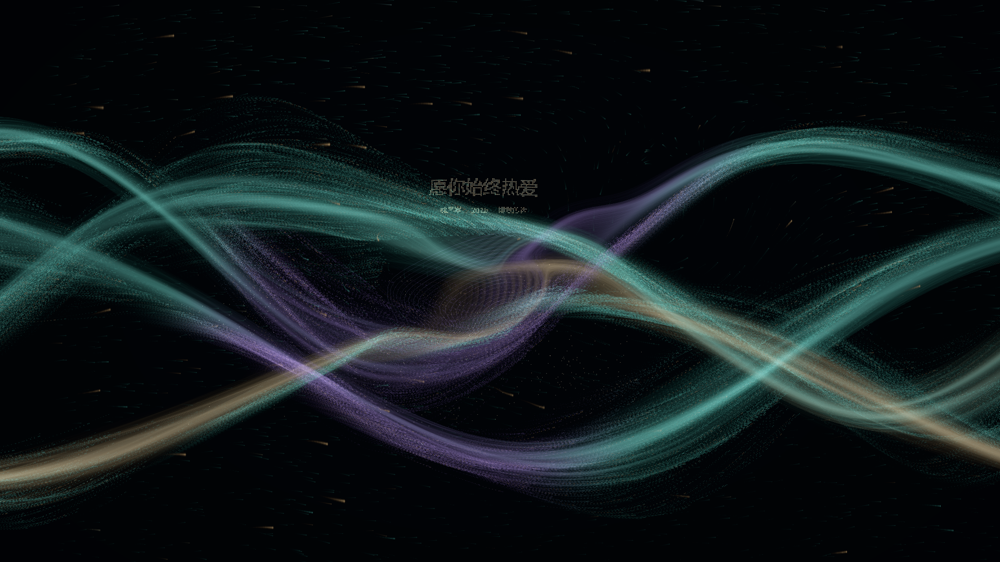
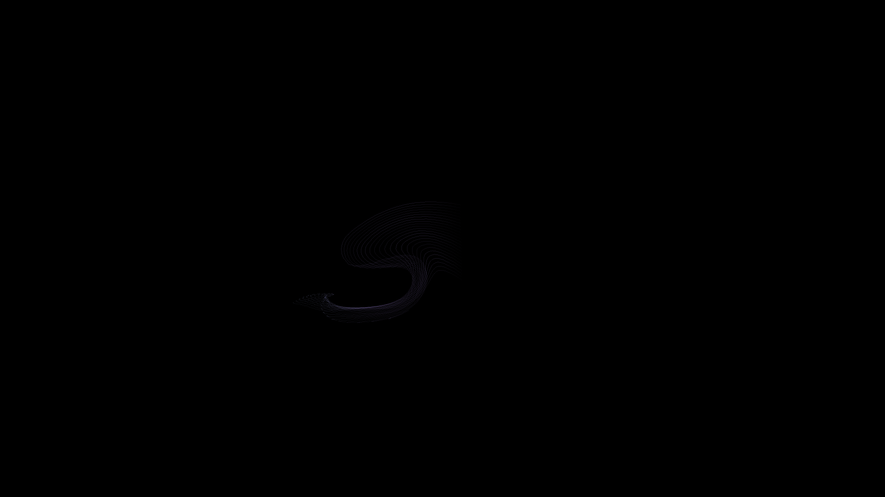
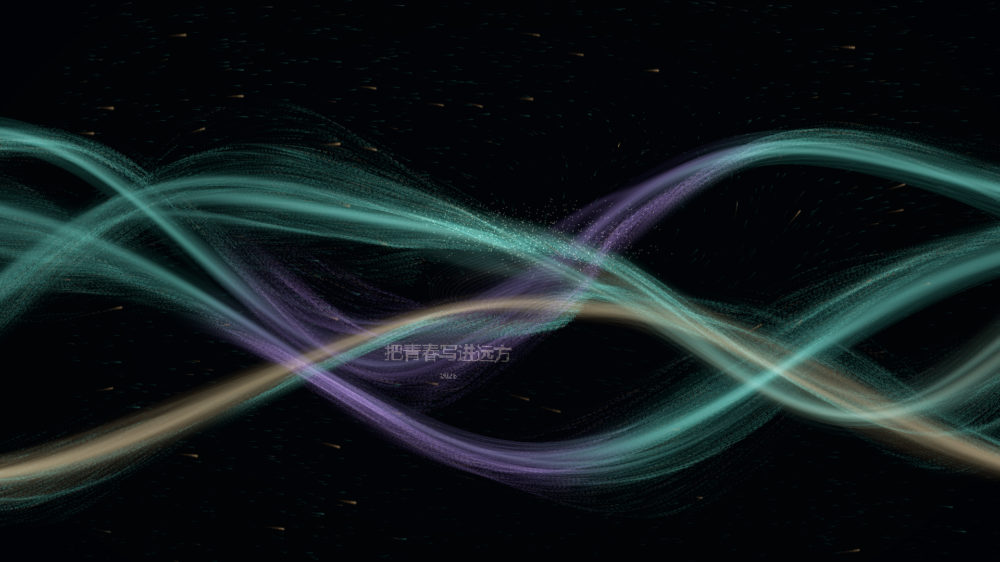

# Body Wake · 连续输运尾迹

启动：`npm.cmd run dev`，打开终端显示的本机网址。默认请求摄像头权限。

## 本次纠正

上一版 `WakeLayer` 用角度、半径和年龄直接算螺旋点的位置，尾涡只是叠加图形，并没有改变河流运动。本版删除该绘制算法。

现在旋涡中心只代表不可见的速度源。主河流 GPU 粒子经过它时改变速度，现有丝绸产生局部弯曲；连续释放的辅助光丝也在相同速度场中输运。其卷曲形态来自各个物质点的运动历史，没有预设圆圈、螺旋形状或固定角速度。

## 输入与坐标

- 双肩与双髋都可靠时，取四点平均；只有双肩或只有双髋可靠时，使用对应两点中心。每点需位于画面内且置信度至少 0.65。只有单侧一个点时暂停新触发，避免用不稳定估计代替躯干。
- 输入已经经过摄像头镜像和 cover 裁切，Pose 只翻转一次 y。横向距离、速度与半径均使用屏幕高度单位修正宽高比。
- 按采集时间戳计算速度，位置平滑 0.22 秒、速度平滑 0.16 秒。重复帧不重复求导。横移启动阈值 0.045 屏幕高度/秒，退出阈值为 55%。静止确认约 0.18 秒。
- 肩/髋来源切换、跟踪中断或异常跳点时重新建立速度基准，不能把解剖部位的位置差当成运动。第一帧不生成尾涡，后续持续移动可再次触发。
- 尾涡直接读取映射后的原始 Pose，不依赖星座的显示数量或肩部有效性判断。因此只有髋部时，即使星座淡出，尾涡输入仍能工作。

## 速度场与实际河流

`BodyWake.ts` 保留有上限的脱落速度源池。横移后在身体经过的后方生成，相邻源交替旋转。默认最多 3 个；生成间隔 1.2 秒并随速度调整，最短 0.65 秒；最小位移 0.10。默认半径 0.11，逐渐扩张但不超过 0.20；约 10 秒后消散。

`wakeField.ts` 中 CPU 与 GLSL 使用相同的连续切向核：

```
r = (P - C) * vec2(aspect, 1) / radius
v += vec2(-r.y, r.x) * signedStrength * 2.85 * exp(-1.5 * dot(r,r))
v /= sqrt(1 + dot(v,v) / 0.16²)
```

中心速度为零，没有除以距离的奇点，没有持续向心吸引。重叠后的总旋转附加速度平滑限制在 0.16 屏幕高度/秒以内。强度在约 1.1 秒内增长，随后按寿命平滑衰减。中心脱离身体后，读取 `riverSpine.ts` 的局部流向漂移，停止运动不再生成，但已有速度源继续演化。

`organicShaders.ts` 将该场加入实际河流粒子的期望速度。在局部影响范围内减弱原来的回流束校正及部分顺流速度，允许材料卷起；范围外保留原有河流。粒子仍保留速度惯性。Mask 绕流、手腕力仍有独立的合计预算，避免强力叠加。

`SilkLayers.ts` 保留原有材质和构图，对局部顶点做短程速度场输运及平滑位移限幅。它是柔性视觉近似，不是完整流体求解，也不是有历史状态的布料模拟。

## 连续光丝

`WakeLayer.ts` 在移动的身体后方每 0.055 秒释放一排材料点。不同排中属于同一发射位置的点连接为 streakline（连续释放形成的流迹线）。每一点都有持久位置和速度，随后由河流加旋转场逐步推进，不跟随身体平移，不按圆周排布。

CPU 辅助光丝采用不超过 1/60 秒的子步和速度惯性；最多 220 排 × 32 点。相邻点过远或输入中断时断开连接，避免跨屏连线。停下后不再释放新点，已有材料继续变形，随寿命淡出。主河流的 65,536 个粒子仍在 GPU 计算。本阶段没有把辅助光丝迁移到 GPU，也没有实现 Navier–Stokes 压力求解。

## 观察入口与参数

右下角「参数」→「人体尾涡 / Body Wake」保留现有全部参数。

- 关闭：清除速度源和辅助光丝，主河流继续运行。
- 仅尾涡：隐藏主河流、文字和星座，检查输运光丝。
- 河流合成：默认；观察主光带与尾迹的共同卷动。
- 鼠标轨迹：无需按键，缓慢左右移动鼠标模拟躯干；停止、离开画布都会停止释放。

无摄像头测试：

- `http://127.0.0.1:5173/?camera=off&input=mouse&wake=only`
- `http://127.0.0.1:5173/?camera=off&input=mouse&wake=composite`

默认旋转强度调整为 0.10。半径、强度、方向、寿命、扩散与消散参数在速度源生成时保存，作用于后续新源；数量上限调低时已有源自然消散。主河流保护约束人体附加作用及局部形变，不再完全隔离尾涡对主粒子的影响。密度控制辅助光丝，不改变主粒子总数。

## 验证与限制

执行 `npm.cmd test`、`npm.cmd run build`；浏览器执行 `npm.cmd run test:browser`。单元测试覆盖单独肩/髋输入、来源切换无假速度、静止噪声、丢失、上限与消散、旋转核有界，以及实际输运函数在 30/120 fps 下的路径差异。浏览器用鼠标和合成 Pose 检查运动、停止、漂移、识别丢失及两种部分躯干输入。

下面是实际 Edge / WebGL 截图，不是设计稿；辅助光丝已有开放弯曲，主流局部产生卷动。截图无法验证真人识别和整段运动的美感，软件 WebGL 的运行也不能代替目标显卡帧率测试。





现场请分别测试：仅肩入镜、仅髋入镜、全躯干入镜；静止与挥手不连续触发；左右横移方向与镜像一致；停止后不再新增，尾迹继续舒展并消散。还需在 1920×1080 大屏确认亮度、流畅度、局部弯曲是否足够自然，以及辅助光丝是否过细。当前仍是艺术化近似，不保证形成规则的卡门涡街。


## 头部中心扰动（2026-10-22）

头部独立于躯干跟踪，优先使用双耳中心，双耳不可用时使用双眼中心，再回退到鼻部。来源变化重新建立速度基准，避免位置跳变触发。头部仅在横移超过稍高阈值后释放较小尾涡：半径 65%、旋转强度 55%，位置平滑时间为躯干的 1.25 倍。与躯干共用数量上限及至少 0.65 秒的全局生成间隔。头部和躯干同时运动时优先服务等待更久的输入；只有头部运动时，辅助光丝也在头部后方释放。实际转头噪声与摄像头遮挡仍需真人验证。
