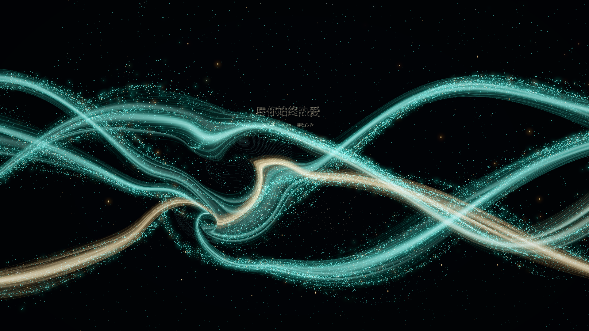
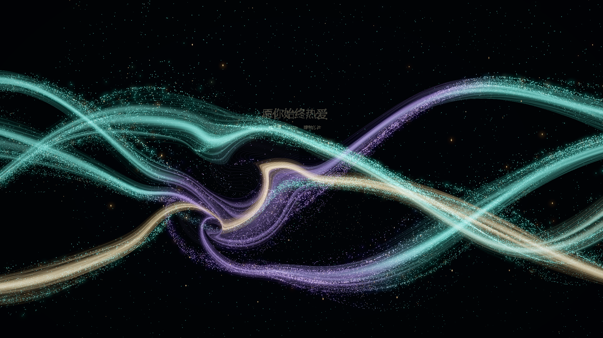
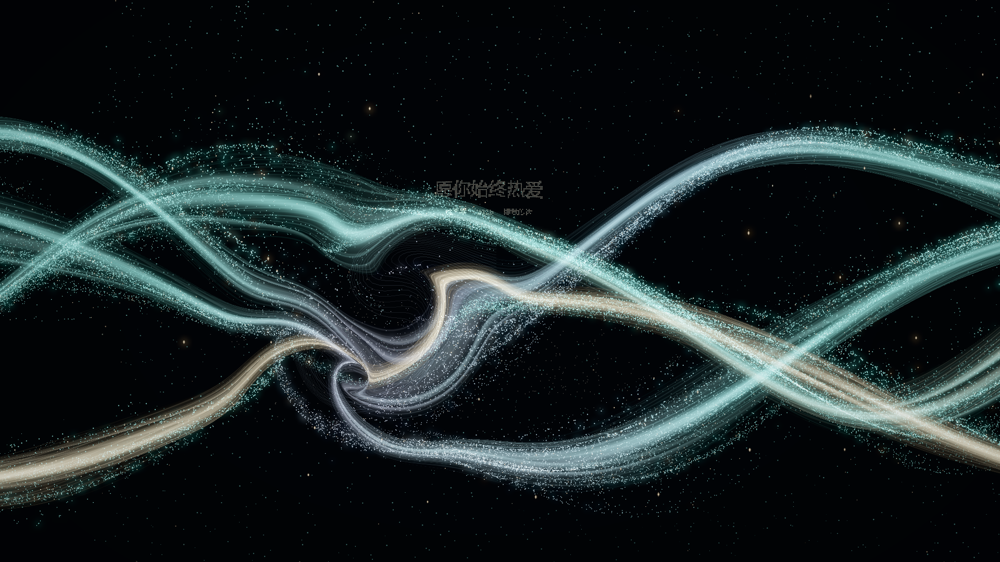

# 视觉色彩系统 · 三种艺术预设

## 使用

运行 `npm.cmd run dev`，打开终端网址，点击右下角「参数」或按 `D`，展开「视觉配色」。当前默认 **B · Teal & Violet**；A · Original 保留为可选的原配色。

| 预设 | 颜色与作用 |
| --- | --- |
| A · Original | 保留原有青绿 `#43B6AA` 与香槟金 `#E5B979`；默认亮度、透明度、Bloom 和运动均沿用既有设置 |
| B · Teal & Violet | 青绿 `#65D5C8`、紫罗兰 `#9878CD`、暖金 `#E5BB81`、冷白 `#C2ECF0`；紫色主要出现在部分次级流束和尾涡，局部核心更接近 `#9878CD` |
| C · Iridescent | 青绿 `#79C9C2`、蓝紫 `#969CC9`、淡粉 `#D2B5C7`、香槟金 `#DCC49E` 与冷白 `#D3E5E9`；有限颜料之间的柔和混合，不使用 RGB / HSV 彩虹循环 |

也可通过 `/?palette=tealViolet` 或 `/?palette=iridescent` 直接进入指定预设。这类入口沿用默认自动摄像头行为；无摄像头比较可追加 `&camera=off`。

原有「河流颜色」「记忆高光」继续用于 Original 的自定义。B / C 使用各自的预设颜料；切回 A 恢复原自定义颜色。

## 参数

| 参数 | 默认值 | 行为 |
| --- | --- | --- |
| 配色预设 | Teal & Violet | 运行时选择，约 1.2 秒的指数平滑时间常数，数秒内完成主要过渡 |
| 辅助色比例 | 0.20 | 限制次级流束的辅助色权重，不是屏幕像素占比；Original 不加入新色 |
| 饱和度 | 1.0 | 在线性色彩中调整；可降低至 0.35 或略增至 1.20 |
| 颜色变化速度 | 1.0 | 0 为暂停色彩时钟；1 时主色带周期约 39 秒；调整速度不会跳相位 |
| 交互色彩强度 | 0.65 | 尾涡附近的紫色及成熟金色权重；只影响色彩，不影响旋转力 |
| Bloom 柔光 | 0.28 | 0 可关闭柔光；B / C 在此值基础上自动减弱最多 15%，保留丝线细节 |

配色与颜料插值在 Three.js 线性工作色彩空间中进行，最终仍由各自原有显示路径转换到 sRGB。

## 实现与色彩层级

新增 `src/render/ColorSystem.ts`，集中保存预设、平滑参数、色彩时钟与尾涡配色信息。主粒子、丝绸、记忆文字和辅助尾迹共用该系统。

- 主流保持青绿，次级流束才具有明显辅助色资格；颜色由连续的屏幕空间波形调制，沿左到右的流动方向缓慢传播。
- Iridescent 在蓝紫与淡粉之间做少量连续混合，同时保留青绿主基底与暖金记忆支流。
- 文字主要保留暖金，少量粒子与成熟尾涡细节具有金色高光；细小高亮点可偏冷白。
- 人体星座既有的冷白／浅青节点及少量暖金维持原设定，不随预设轮流变色。
- Original 默认走保留原颜色的路径，不引入新色相、额外透明度或亮度变化。全局饱和度和 Bloom 仍可手动调节。

新增颜料在混合前限制在线性亮度预算内，不抬高原渲染层的亮度。没有提高曝光、节点亮度或叠加额外光带；保持现有透明度和 HDR 显示方式。高饱和度或高 Bloom 手动设置仍需结合实际屏幕判断。

## 与尾涡生命周期同步

颜色只读取已有 `BodyWake` 的中心、半径、强度、年龄和寿命，不修改人体运动检测、脱落规则、旋转核、材料输运或 Mask 绕流。

1. 形成：约 1.1 秒内逐渐建立紫色权重。
2. 发展与成熟：生命周期约 15%–30% 时金色逐步出现，主要落在少量亮点及细节上。
3. 漂移：颜色场跟随现有脱落源，在空间上高斯衰减，避免硬边色块。
4. 消散：金色先退，紫色在后半段逐渐回到主河流色；源寿命结束后无残留色场。

辅助色时钟不由摄像头随机触发。预设切换不会重建 GPU 粒子、清除运行中的尾涡或重置人体输入。

## 同状态比较与验证

`tests/browser/color.spec.ts` 在同一页面关闭摄像头，用同一段鼠标轨迹生成尾涡，然后冻结当前动画和输入。依次只替换预设，并以同一冻结状态重新积累拖尾，获得下列 1920×1080 实际 Edge / WebGL 截图。

测试读取 GPU 中 16 个粒子的完整位置与速度，逐预设严格比较；也检查切回 Original 后截图能一致复现。冻结对比只在开发 `?qa=1` 暴露，不进入默认展示界面。冻结积累让光点比实际移动拖尾更集中，因此截图用于比较色彩，不能用来衡量动态流畅度或实际帧率。

### A · Original

### B · Teal & Violet

### C · Iridescent

实际查看结果：三套构图和卷动结构一致；B 的次级流束及尾迹呈现更浓郁的紫罗兰，C 更偏灰粉紫和珠光，主体仍是青绿。交叠保留青绿、冷紫与金色的区别，未通过全面增加光强制造新效果。

23 项单元测试、生产构建及 16 项开发浏览器回归全部通过，配色浏览器测试覆盖同状态截图、运行时选择及关闭 Bloom。

首版（本轮强化紫色之前）的同状态截图每隔 4 像素采样，平均显示亮度（0–255）A / B / C 为 33.407 / 33.134 / 33.587；RGB 三通道均 ≥245 的近白采样比例为 0.0046% / 0.0154% / 0.0216%。新增预设没有显著抬升该场景整体亮度，但局部近白比例有所增加，仍应在大屏上检查高光。这不是所有动画时刻的曝光保证。完整结果同步记录在根目录开发日志。测试使用软件 WebGL；真实 USB 摄像头条件下的尾涡配色、目标显卡帧率与大屏色彩仍需现场确认。

## 2026-10-22：默认 B 与浓郁紫罗兰调整

默认切换为 B。之前青绿和紫色在线性空间中大比例混合，加上冷白高光与 HDR 累积，紫色容易呈现偏白的灰蓝色。本次保持辅助色作用范围，将局部紫色核心的颜料权重提高至最高 96%，减少该处冷白混入，并最多降低约 28% 的紫色辐射亮度，减少显示曲线把颜色压向白色的问题。

没有整体提高饱和度或增加紫色光带数量；A 原配色和 C 珠光路径保留。共享材质同时作用于主粒子、丝绸和尾迹，几何、流场与人体交互不变。网页叠光与屏幕显示会改变最终像素，`#9878CD` 是目标颜料与视觉方向，并非要求所有紫色像素输出同一十六进制颜色。

构建与 23 项单元测试通过。本轮实际截图及浏览器检查结果见开发日志；上方截图由配色测试生成，会随最近一次运行更新。
