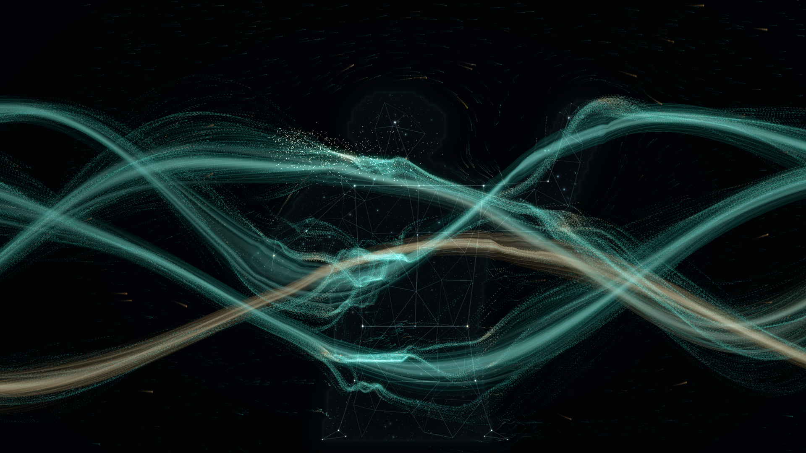
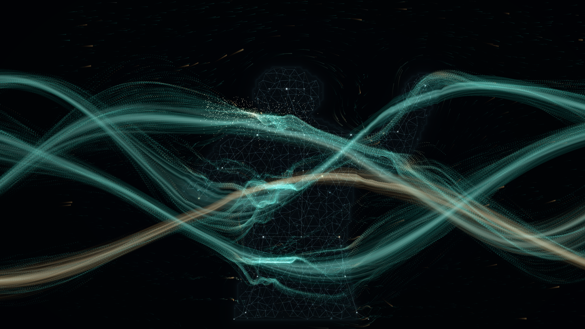
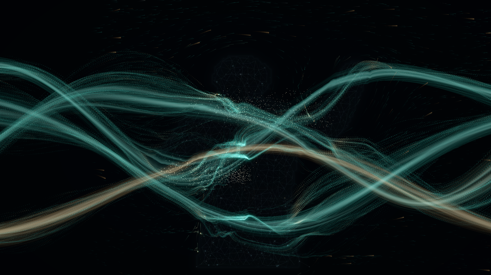
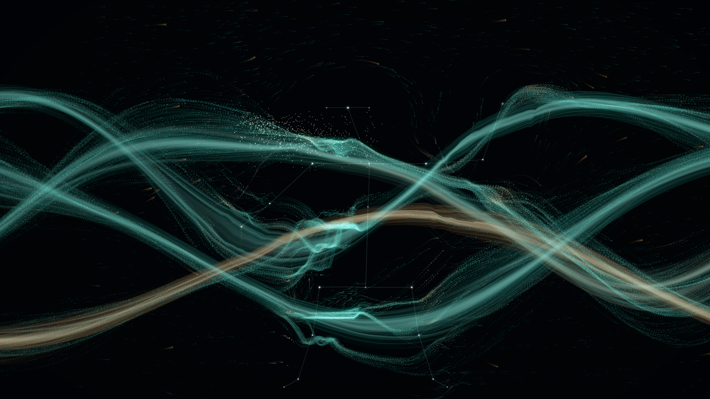
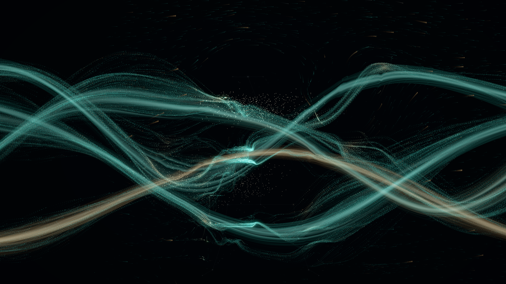

# Human Constellation · 单人人体星座

## 运行和查看

当前电脑已下载新增模型。执行 `npm.cmd run dev`，打开终端网址后，项目会自动请求摄像头权限；首次使用时请在浏览器提示中选择“允许”。拒绝后可点击“开启摄像头”重试。更新已有安装或换电脑时先执行 `npm.cmd run assets`，会准备 `pose_landmarker_lite.task`；正式运行不依赖 CDN。

默认沿用当前完整记忆河流，增加星座感知，无额外识别框、编号或文字标签。`D` → “人体星座”可开关感知，并调整节点大小/亮度、连接线透明度、运动平滑度、星光拖尾长度和手腕吸引强度。`H` 可隐藏所有界面。

新增“身体星尘密度”“身体细网”“轮廓光雾”三项参数。默认同时呈现身体内部细小星尘、少量较亮星点、不规则三角细网、淡青轮廓光雾；无需增加模型或重新下载资源。

按最新反馈，细网由 78×46 改为 25×15，候选连接数量约为原来的十分之一，单格宽高约增大三倍。星尘、光雾及关节连接保持原有设置。此调整已通过构建及星座浏览器场景，并检查实际渲染截图。

## 数据和视觉

原项目只有 Image Segmenter 的人体 Mask，没有现成关键点。本次在同一经典 Worker 中增加 Pose Landmarker Lite，`numPoses=1`，使用 CPU/WASM 避免抢占河流 GPU。姿态最多 15 次/秒，与分割共享单帧背压；不累积视频帧。模型初始化或推理失败时，仅关闭姿态，保留 Mask 交互并提示。

摄像头按窗口画幅居中裁切、镜像后进入同一张 640×360 图像，分割和姿态都使用这张图。PoseTrack 只将 y 翻成渲染器底部原点，不再次镜像；所有位置均为归一化屏幕坐标。曲线厚度、运动速度与手腕作用半径按实际宽高比修正。z 数据保留，当前视觉使用二维投影，避免三维姿态推断改变屏幕位置。

主要星点包括头部、肩膀、肘、腕、髋、膝、踝和少量次级点。颈、胸和髋中心由已跟踪关节插值得出，置信度继承父节点。关节采用共同的自适应平滑；曲线端点始终使用同一组节点坐标，只对中段弯曲作轻微惯性，避免端点与关节脱离。

目前启用全部 33 个 MediaPipe 关键点及 3 个辅助点，共 36 个发光节点、44 条局部连接。新增眼部、耳侧、嘴部、手部和脚跟连接；面部与手部节点更小更淡，线条更细，短连接的弯曲幅度随长度减小，避免密集细节糊成亮团。置信度不足时节点及相邻连接仍平滑淡出。身体三角细网维持 25×15 的稀疏设置。

36 节点版本已通过生产构建、11 项单元测试、2 项星座浏览器场景；合成完整姿态确认 36 个节点均进入有效跟踪，已检查实际截图。真人面部、手部小节点的稳定性仍需摄像头现场验证。

星点大小、相位和色彩有少量差异，使用独立的柔光 Shader，不提升整条河流的 Bloom。连接为细薄、边缘渐隐的曲线带。关节历史形成短光点拖尾，拖尾长度独立于河流全局拖尾。

身体材质由独立的 `HumanStarField` 模块实现，保留原有河流和关节星座。22,000 个全屏候选星尘由 GPU 按真实 Mask 选择显示，实际可见数量取决于身体占画面的面积与密度参数；亮度、大小和呼吸相位各异。抖动交错网格形成局部三角连接，端点、中点及片元都采样轮廓，避免跨越手臂和躯干之间的空隙。共用网格顶点的轻微呼吸位移，保持连接连续。

星尘和细网使用平滑 Mask 的透明通道与有符号距离共同裁切，避免直接沿用河流慢恢复距离场而留下过大的实体残影。轮廓薄雾则利用距离场形成柔和余光。三层都是 GPU Shader，不在 CPU 上逐帧重新生成粒子或三角网，也不增加全局 Bloom。静止后细网与亮星渐淡但保持最低显示，同时保留星尘，原有节点解体光尘继续漂入河流。

这些细密星点和网格是贴合二维人体轮廓的艺术材质，并非新增识别出的解剖关键点或三维皮肤网格；只有原有主要星点跟随 Pose 关节。横移时身体材质随 Mask 显隐，不能等同于逐点皮肤运动追踪。姿态模型失败而分割可用时，身体材质仍可呈现淡薄星尘与轮廓。

开始跟踪时有短暂的凝聚显影；之后由有死区的运动量驱动。静止数秒后，结构缓慢淡至约 30% 的最低显示，继续保留可辨认的人体姿态，光尘从节点出生并逐渐跟随既有流束函数；恢复运动后重新凝聚。这里没有因为静止而停止关键点检测。

两只手腕的平滑位置、置信度和运动强度写入现有 GPU 运动 Shader，局部叠加有衰减范围的吸引和相反方向旋涡。星座消散、被遮挡或关闭后，作用力随置信度和凝聚程度减弱。原有粒子、丝绸、记忆文字及 Mask 排斥系统均保留。

## 验证与限制

全身星尘与细网更新：生产构建、11 项单元测试和 5 项开发浏览器检查通过（2 项星座场景、3 项河流/摄像头回归）。已查看新材质运动凝聚及静止淡化的实际截图；浏览器未报告 Shader 编译或运行错误。本轮未重新执行生产浏览器套件，也未验收真人摄像头或硬件 GPU 帧率。

五项新单元测试覆盖：屏幕映射、派生关节对齐、静止/运动切换、失去跟踪与手腕力渐退、离群点与画外关节。浏览器场景使用明确标识的合成关键点和不对称 Mask，检查运动显影、手腕坐标/有效影响、遮挡、静止消散和 Mask 共存，并抓取实际渲染截图。

另以模拟摄像头运行真实 Pose + Segmenter 模型，检查两者初始化、连续回传和关闭恢复。模拟视频没有真人，它验证的是模型链路；合成点验证的是视觉和映射逻辑，不能证明真实相机的人体识别准确率。生产版禁用合成数据注入。

本次结果：TypeScript 与生产构建通过，11 项单元测试通过，合成姿态浏览器场景通过；生产版 4 项浏览器检查通过（包含真实模型初始化/连续回传、姿态模型加载失败时保留 Mask、权限拒绝和 GPU/界面回归），1 项开发专用合成姿态检查按设计跳过。已人工查看运动显影和静止消散的实际截图。真实 USB 摄像头与真人全身效果仍待现场确认。

当前只支持单人。没有在未验证实际摄像头前扩展多人识别。需要在现场用真人完成：

1. 站在能容纳全身的距离，缓慢抬左右手，核对星点与真人同向、比例一致。打开轮廓调试时，星座和 Mask 应同时贴合。
2. 快慢移动手臂、弯肘和屈膝，观察端点是否贴住节点、手腕附近是否出现轻微汇聚/绕动。
3. 遮住手腕或让腿离开画面，确认相应节点与线条渐退；不应绘制出画面的猜测关节。
4. 静止约 8–12 秒，确认星点解体为光尘；重新运动时应平滑凝聚。离开画面后星座消退，而河流和旧光尘继续自然运动。
5. 在目标 1920×1080 大屏持续运行，确认亮度克制、节点仍可辨认、帧率稳定。推理帧率取决于 CPU，不能以软件 WebGL 的测试帧率代替现场性能。

实际浏览器预览（合成姿态）：

增加全身星尘与细网后的 1920×1080 浏览器截图（合成 Mask 和姿态，非真人摄像头验收）：

以下为之前的稀疏关节版本，供对比：

API 依据：[MediaPipe 官方 Web Pose Landmarker 文档](https://developers.google.com/edge/mediapipe/solutions/vision/pose_landmarker/web_js)。
